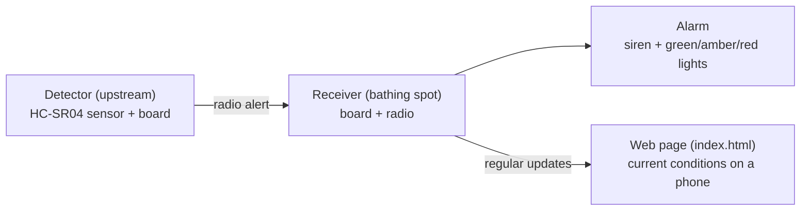

# Our TRD

TRD = Technical Requirements Document: **how** we'll build what our PRD describes. Finished by the end of **Week 4**.

## 1. Our system
Draw three boxes and put a photo in `sketches/`:
- **Front:** what our persona sees and taps
- **Data:** the information our product uses
- **Rules:** what happens when they tap

> 📷 Hand-drawn photo of the three boxes still to add: `sketches/system.jpg`

- **Front:** the **alarm** at the bathing spot (siren + green / amber / red lights), and the **web page** (`index.html`) that shows the current conditions at the bathing spot on a phone.
- **Data:** the **water level** measured by the HC-SR04 sensor on the detector, and the **alert level** (safe / watch / danger) worked out from how fast the level is changing.
- **Rules:** the **detector** checks whether the water is rising fast (several readings in a row, so one splash doesn't count). If it is, it sends an alert by radio. The **receiver** turns the alarm on and sends the latest reading on to the web page.

## 2. Screens
One line per screen, from PRD section 5.

1. **Alarm (physical):** green light = safe, amber light = watch (river rising faster than normal), red light + siren = danger (get out of the river now).
2. **Web page, conditions:** the bathing spot's name, its colour (green / amber / red), the water level, and when it was last updated.
3. **Web page, what to do:** what each colour means and what to do (for example, red = leave the river and go to higher ground).

## 3. Data

| What information? | Where does it come from? | Who updates it? | How often? |
|---|---|---|---|
| Water level (distance from the sensor down to the water) | HC-SR04 sensor on the detector | The detector, automatically | Every reading, over and over (exact interval set during testing) |
| Alert level (safe / watch / danger) | Worked out on the detector from how fast the water level is changing | The detector's rules, automatically | After every reading |
| Alert message | Detector → receiver over the radio | The detector, automatically | When the alert level changes |
| Current conditions on the web page (level, colour, last updated) | Receiver → web page | The receiver, automatically | Regularly (exact interval set during testing) |
| Bathing spot name and what each colour means | Written by us in `index.html` | Mylo | When something changes |

## 4. Level and tools
- **Level** (from The Stack): **1 · Live**, because the web page shows live readings from the hardware.
- **Built with:**
  - the web page: one `index.html` with HTML, CSS and JavaScript
  - the detector and alarm: a microcontroller board, an HC-SR04 ultrasonic sensor, a radio module, a siren/buzzer, LEDs, a battery and a solar panel (which board and radio is still open, see section 8)

## 5. Files
| File | What it does |
|---|---|
| `index.html` | The web page: shows the current conditions at the bathing spot and what each colour means |
| `hardware/detector/` | Code for the detector: reads the sensor, decides if the water is rising fast, sends the alert by radio |
| `hardware/receiver/` | Code for the receiver: listens for alerts, turns on the siren and lights, sends updates to the web page |
| `sketches/` | Photos of our hand-drawn system and screen designs |
| `presentation/final.pdf` | Our Demo Day slides |

## 6. Done when (our tests)
When I [do something], I should see [result]. At least one test for someone using it wrong.

1. When I quickly move water (or a flat board) closer to the detector's sensor and keep it there, I should hear the siren and see the red light at the receiver within a few seconds.
2. When the water level stays the same, I should see the green light and hear no siren.
3. When I splash or wave my hand under the sensor just once (a bad reading), I should see the alarm stay green, with no siren. *(someone using it wrong)*
4. When I unplug or switch off the detector, I should see the web page show that the detector is offline or that the update is old, and **not** show "safe". *(something going wrong)*
5. When I open the web page on my phone, I should see the bathing spot's colour, water level and last-updated time without zooming in.
6. When I cover the detector with the weatherproof case and spray it with water, I should see it keep working.

## 7. Where it lives
`https://myloc15.github.io/river-watch/` (GitHub Pages, from this repo)

## 8. What we don't know yet
Questions to bring to the Vibe Jam.

1. **Which board and radio?** ESP32 + LoRa module, ESP32 + ESP-NOW, or Arduino Uno + LoRa module?
2. **How do readings get from the receiver to the web page?** GitHub Pages only shows files, so it can't receive data by itself. Where should the receiver send its updates so `index.html` can read them?
3. **What counts as "rising fast"?** How many centimetres in how many minutes should set off amber, and how many should set off red? We need to test this.
4. **The HC-SR04 isn't waterproof.** It's fine for testing, but will it survive at the river, or do we need a waterproof sensor there?
5. **How far does the radio reach** along the river at Uvita, with trees and bends in the way?
6. **Where do the detector and the alarm go**, and who do we ask for permission?
7. **Is the solar panel enough** to keep the battery charged on cloudy, rainy days?
8. **How loud does the siren need to be** to be heard over a rushing river?

Checked by mentor: ______
